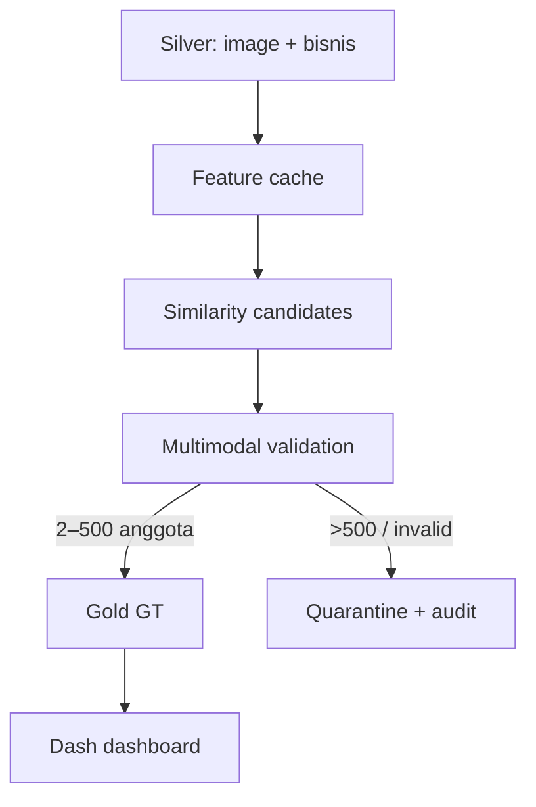

# Arsitektur DB-First

## Pemisahan tanggung jawab

- `silver` adalah corpus mentah seluruh gambar.
- `processing` menyimpan jejak komputasi sehingga hasil dapat diaudit dan stage dapat dilanjutkan.
- `processing.gambar_reused` adalah hot BYTEA store khusus evidence Gold aktif.
- `gold` hanya berisi data yang sudah lolos validasi dan dibutuhkan dashboard.
- Dashboard tidak melakukan similarity, recluster, validasi, atau join besar ketika user membuka halaman.

## Publication model

Setiap eksekusi mempunyai `run_id`. Hasil lama tidak dihapus. Saat stage publish berhasil dalam satu transaksi:

1. signature group dicocokkan dengan `gold.group_registry` agar `group_id` stabil;
2. hasil aktif sebelumnya untuk `source_group` yang sama diberi `is_active=false`;
3. group, detail, dan summary baru dimasukkan dengan `is_active=true`;
4. view dashboard otomatis hanya melihat versi aktif.

Jika publish gagal, transaksi rollback dan dashboard tetap membaca versi Gold sebelumnya.

## Kecepatan dashboard

Dashboard hanya preload dua dataset kecil: group summary dan detail GT. BYTEA
tidak ikut preload. Ketika thumbnail dibutuhkan, endpoint mencari
`file_uid`/`file_name` pada `processing.gambar_reused`. Fallback ke Silver
default dimatikan agar halaman tidak memindai corpus besar atau relation lama
yang rusak.
